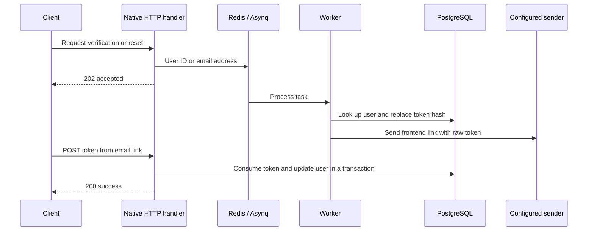

# Auth Email

Full projects provide these flows for Gin, stdlib, and Fiber. Minimal projects omit authentication and workers. The implementation is tracked in [#49](https://github.com/zoe606/gobase/issues/49) and the [execution plan](https://github.com/zoe606/gobase/blob/master/docs/plans/auth-email-flows.md).

## HTTP Contract

All routes use the existing response envelope and request IDs. Register and login still return tokens immediately. Email verification does not prevent login and is requested explicitly after registration.

| Route | JSON body | Authentication | Success |
|-------|-----------|----------------|---------|
| `POST /v1/auth/resend-verification` | None | Access JWT; requests only for its user | 202 |
| `POST /v1/auth/verify-email` | `{"token":"<64 hex characters>"}` | Token possession | 200 |
| `POST /v1/auth/forgot-password` | `{"email":"user@example.com"}` | Public | 202 |
| `POST /v1/auth/reset-password` | `{"token":"<64 hex characters>","new_password":"replacement-password"}` | Token possession | 200 |

Password reset requests return the same message for known and unknown addresses. The HTTP handler enqueues the request before any account lookup. The worker looks up the account and skips unknown or inactive users. Verification requests use the JWT user ID and skip verified or inactive users in the worker.

Passwords require at least eight characters and at most 72 bytes. Invalid fields return HTTP 400 with `VALIDATION_ERROR`. Malformed JSON returns `INVALID_JSON`. Invalid, expired, or consumed tokens return HTTP 400 with `INVALID_VERIFICATION_TOKEN` or `INVALID_RESET_TOKEN`.

## Configuration

Start the Full app with PostgreSQL and Redis as described in [deployment](deployment.md). Apply migrations before starting the worker. For local Go processes, export the following values in both terminals or configure them in `config/config.yaml`. Copying `.env` alone does not export variables to local Go processes.

```bash
export EMAIL_PROVIDER=resend
export EMAIL_API_KEY='<your Resend API key>'
export EMAIL_FROM_EMAIL='sender@your-verified-domain.example'
export EMAIL_VERIFICATION_ENABLED=true
export EMAIL_VERIFICATION_AUTO_VERIFY=false
export EMAIL_VERIFICATION_TOKEN_TTL=24h
export EMAIL_VERIFICATION_BASE_URL=https://app.example.com
export PASSWORD_RESET_TOKEN_TTL=1h
export PASSWORD_RESET_BASE_URL=https://app.example.com
```

Use a verified sender configured in your Resend account. The built-in provider is Resend. SMTP and other providers need their own `email.Sender` implementation. `noop` remains available for development welcome-email tasks and does not send token emails.

Run `make run` and `make run-worker` in separate terminals. Auth email tasks use `ASYNQ_MAX_RETRY` and `ASYNQ_JOB_TIMEOUT`, with defaults of three retries and five minutes. `202` means the request was accepted; it does not confirm email delivery. Worker delivery errors are retried. Exhausted tasks are archived. Inspect worker logs and Asynq task state when delivery fails.

| Condition | Behavior |
|-----------|----------|
| Missing API key, invalid sender, unsupported provider, invalid frontend URL or nonpositive token TTL | Token email requests return 503 `AUTH_EMAIL_UNAVAILABLE` |
| Redis queue unavailable | Both known and unknown password reset requests return 503 `AUTH_EMAIL_UNAVAILABLE` |
| `EMAIL_VERIFICATION_ENABLED=false` | Verification and resend return 503 `EMAIL_VERIFICATION_DISABLED`; password reset remains independent |
| `EMAIL_VERIFICATION_AUTO_VERIFY=true` outside production | JWT-protected resend verifies only its authenticated user without sending email; intended for local development |
| `EMAIL_VERIFICATION_AUTO_VERIFY=true` in production | Resend returns 503 `AUTH_EMAIL_UNAVAILABLE`; set it to `false` for delivery |
| Provider unavailable after a token was issued | Existing tokens can still be consumed |

The default development configuration has auto-verification enabled. Set it to `false` to exercise delivery. Sender configuration is checked locally; invalid credentials or provider outages are detected by the worker during delivery.

## Frontend Links and Token Storage



Links use the configured frontend base URL followed by `/verify-email#token=...` or `/reset-password#token=...`. A base path is retained. URLs must be absolute HTTP(S), without user information, query parameters, or fragments. Production requires HTTPS. Request Host headers are not used to construct links.

The application does not include frontend pages. Your frontend reads the fragment, removes it from browser history, and submits the token in the POST body. Keep these pages free of third-party scripts that can read the fragment. Tokens do not belong in query parameters or logs.

The worker generates 32 random bytes and stores a SHA-256 hash in the existing token column. Raw tokens appear only in outgoing email and the token-consumption request. Auth task payloads contain only a user ID or an email address. Request body logging is omitted for verification and reset routes, including malformed JSON. Tokens expire and can be consumed once. Each new delivery attempt replaces prior tokens for that user and purpose. A retry can therefore invalidate a link from an earlier delivery attempt.

Duplicate requests with the same payload share a task ID within the same calendar minute. This reduces repeated email requests; it is not a rolling per-account rate limit. Adjacent minute boundaries can accept two requests close together. The existing IP rate limit still applies.

Password changes, token consumption, and refresh-token deletion run in one database transaction. Failure rolls back all changes. Password reset invalidates all refresh tokens and removes outstanding reset tokens. Existing stateless access JWTs remain valid until their configured expiry. Already generated applications need explicit adoption of these changes. Previously issued plaintext tokens do not match the new hash lookup; request a new token after adoption. No schema change is required.

The design follows the [OWASP Forgot Password guidance](https://cheatsheetseries.owasp.org/cheatsheets/Forgot_Password_Cheat_Sheet.html) for consistent account responses and expiring, single-use tokens.

## Verification

The Engines workflow generates each Full engine and runs `integration-test/authemail` with real HTTP processes, PostgreSQL, Redis, and a separate worker with a controlled sender. It checks validation, trusted email links, hash persistence, unknown accounts, expiry, replay, concurrent consumption, rollback, refresh-token revocation, retry exhaustion, malformed tasks, queue failures, and configuration behavior. Focused use-case tests cover production auto-verification rejection and HTTPS requirements.

To run the same fixture locally, use a dedicated test PostgreSQL database and a dedicated Redis instance. Redis database 14 must be empty. The fixture owns its keys and removes them after all processes stop. It leaves test database records in place.

```bash
AUTH_EMAIL_TEST_ENABLED=true \
POSTGRES_HOST=127.0.0.1 POSTGRES_PORT=5432 \
POSTGRES_USER=postgres POSTGRES_PASSWORD=postgres \
POSTGRES_DBNAME=auth_email_test POSTGRES_SSLMODE=disable \
REDIS_HOST=127.0.0.1 REDIS_PORT=6379 \
go test -count=1 -race -timeout=4m -v ./integration-test/authemail
```

The fixture creates and stops its own app and worker processes. It captures email content and simulates sender errors. It does not call Resend and does not establish external inbox delivery. Verify the real sender separately with your provider account before deployment.
