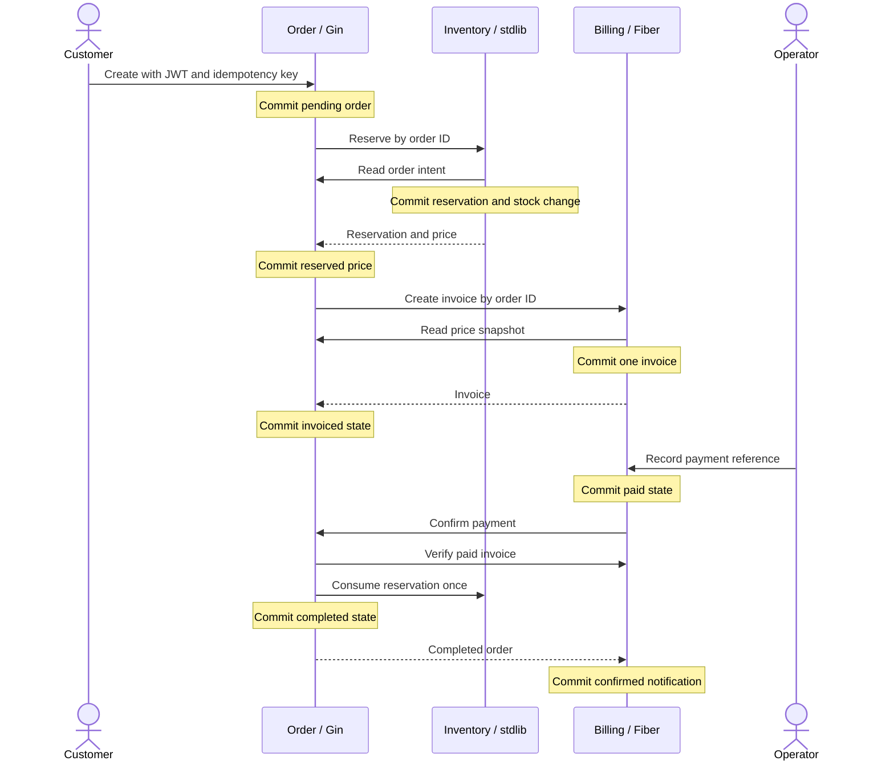

# Commerce Verification

Updated: October 12, 2026.

## Scope and Revisions

The initial Commerce workflow is implemented in three independent private repositories. Each owns its module, native HTTP handlers, migrations, data, tests, configuration, Dockerfile, and CI. The common test fixture belongs to Order. There is no shared Go workspace.

| Application | Engine | Repository | Verified application revision | Local selective coverage |
|-------------|--------|------------|-------------------------------|--------------------------|
| Order | Gin | [commerce-order](https://github.com/zoe606/commerce-order) | `45baeae241f37218d2f3f5f758b566fc174de900` | 85.6% |
| Inventory | stdlib | [commerce-inventory](https://github.com/zoe606/commerce-inventory) | `1dd4467f4097216f392cae019e4687b439d12d3a` | 85.2% |
| Billing | Fiber | [commerce-billing](https://github.com/zoe606/commerce-billing) | `2cc3899243ad7a7f2e5fe90ae2eb6a0bd625a9ca` | 87.0% |

The applications were generated from gobase `2177675e4ea4409e56905f4b2f966dd4d3b755e5` and adopted the generator workflow test from `631ff36515fce259c0eda237c7716feb359cc96d`. These production changes merged in [PR #59](https://github.com/zoe606/gobase/pull/59) as `a611e8406f491bb259d8a120b89f86b1f7ebaab5`.

Local application paths are `.worktrees/commerce-order`, `.worktrees/commerce-inventory`, and `.worktrees/commerce-billing`. They are separate Git repositories under an ignored directory. Product implementation files are not part of the gobase repository.

## Implemented Workflow

One order contains one SKU and quantity. Monetary amounts are integer IDR values. Inventory owns the price. Order persists the accepted quantity and price. Billing records an invoice and a trusted operator's payment reference. This operation does not charge a payment provider.



No database transaction remains open during an HTTP call. A failure preserves the last committed state. The same order key resumes a pending or reserved order. A paid invoice with failed confirmation remains identifiable and can be retried. Repeated reservation, payment, consumption, and confirmation preserve their operation identity.

Internal service and operator credentials are distinct. Inventory's Order credential can read snapshots but cannot confirm payments. Customer reads require ownership. Each application documents exact endpoints and environment variables in its own `docs/commerce.md`.

## Local Verification

The environment uses Go 1.27.2 and golangci-lint 2.14.0 on macOS arm64. PostgreSQL 17 uses TLS with three separately owned databases. Redis 7 uses database numbers 0, 1, and 2. Explicit migrations run before production startup. Fixture host ports are 55430 and 56380.

| Check | Result |
|-------|--------|
| Each application's format, lint, reachable vulnerability scan, race tests, and 85% coverage gate | Passed |
| PostgreSQL repositories and native business handlers with COMMERCE_TEST_DSN | Passed |
| Required credentials, peer URL validation, request IDs, redirects, deadlines, and response limits | Passed |
| Initial workflow with independently running native processes | Ten scenarios passed |
| Non-root Docker images with production configuration | Ten scenarios passed on the recorded application revisions |
| Container identity, config, migrations, CA bundle, temporary files, and writable storage | Passed in local Docker run |
| Restart, retained business state, SIGTERM, and clean final shutdown | Passed |

Coverage excludes the original infrastructure exclusions and generated example HTTP handlers whose routes are disabled in each product. Business handlers, use cases, and repositories remain included. Dormant foundation package unit tests still run. The threshold is 85% in each Makefile and CI workflow.

Inventory locks reservation operations using the canonical PostgreSQL UUID value. A regression test holds the order's lock and verifies that an uppercase UUID cannot bypass it or restore stock before the lock is released. The test failed before the correction and passed afterward. Native and Docker workflow checks passed again with the corrected Inventory revision.

The ten workflow scenarios are:

1. Authentication, access rules, and invalid input.
2. Order, reservation, invoice, payment, stable identities, and conflicts.
3. Eight concurrent orders competing for three stock units. Three succeed and five report insufficient stock.
4. Concurrent creates with the same customer and key. One order and reservation remain.
5. Billing outage after reservation. The same key resumes after recovery.
6. Order outage after payment. The paid invoice retains pending confirmation and recovers.
7. Inventory outage after payment. Retried confirmation consumes stock once.
8. Lost reservation response after its transaction commits. Retrying uses the same reservation.
9. A slow downstream response. The two-second client timeout returns a failure within the tested three-second bound.
10. Application restart. Completed order and confirmed invoice remain persisted.

Repeat from Order after cloning all three application repositories:

```bash
INVENTORY_PROJECT=/absolute/path/to/commerce-inventory \
BILLING_PROJECT=/absolute/path/to/commerce-billing \
bash scripts/commerce-e2e.sh
```

Add `COMMERCE_E2E_DOCKER=1` to run the same workflow with product images. The Docker harness uses `host.docker.internal` on macOS with Docker Desktop or OrbStack. Linux uses host networking so loopback dependencies, peer APIs, and fault proxies remain reachable. Both modes passed in Ubuntu CI as recorded below. Containers have one CPU and 512 MiB each. These limits describe the fixture; they are not measured capacity or a production sizing recommendation.

Process logs and temporary Docker environment files are retained under Order's ignored `integration-test/commerce/.runtime/evidence-<uuid>` directory. Runtime environment files have mode 600. Fixture services retain their test data. Application processes and containers stop after verification.

## Remote CI

Each application's CI applies migrations to PostgreSQL 17 and runs the native handler and repository tests. It also checks formatting, lint, all-package builds, race tests, the coverage threshold, and reachable vulnerabilities. CI results for the business revisions recorded above are:

| Application | GitHub CI | Result |
|-------------|-----------|--------|
| Order | [Run 37912166073](https://github.com/zoe606/commerce-order/actions/runs/37912166073) | Passed |
| Inventory | [Run 37947971768](https://github.com/zoe606/commerce-inventory/actions/runs/37947971768) | Passed |
| Billing | [Run 37912450130](https://github.com/zoe606/commerce-billing/actions/runs/37912450130) | Passed |

These independent quality runs do not execute the full three-application workflow. Order now owns a separate cross-repository workflow, verified below.

### Linux HTTP Workflow

[Order PR #6](https://github.com/zoe606/commerce-order/pull/6) adds Ubuntu native and Docker jobs using the existing ten scenarios. On October 9, 2026, [Commerce E2E run 37954108670](https://github.com/zoe606/commerce-order/actions/runs/37954108670) passed both jobs. [Quality run 37954108608](https://github.com/zoe606/commerce-order/actions/runs/37954108608) also passed. The run head is `265caa41b99b2ddd64e8b9c249a5df08bc8d786a`. The PR checkout is GitHub's merge commit, recorded separately below. The workflow merged on October 11 and is enabled on Order's default branch.

Both artifact revision records identify the same checked-out application commits:

| Application | Checked-out revision |
|-------------|----------------------|
| Order | `658cc72c9702b5ffa1fdab410bdeff423f303df0` |
| Inventory | `1dd4467f4097216f392cae019e4687b439d12d3a` |
| Billing | `7e219a0fe6e9c2a31a9416c406a499e601f94a77` |

The logs confirm Go 1.27.2 on Linux amd64 and ten passed scenarios in each mode. Docker runtime probes passed for all three containers. PostgreSQL TLS, explicit migrations, retained business state, recovery, and clean application shutdown passed. Local native and Docker reruns also passed on the updated harness. Order's local `make check-all` retained 85.6% coverage with the unchanged 85% gate.

Inventory and Billing checkouts use separate read-only deploy keys stored as Order Actions secrets. The keys were verified as read-only. Artifacts contain revision records and runtime logs. Inspection confirmed that environment files and TLS keys are absent. The workflow runs on Order changes and accepts manual candidate peer revisions. Peer pushes run their own CI and do not automatically trigger this common workflow. Each repository remains independently owned.

### Post-Merge Verification

On October 11, [Commerce E2E run 38151098408](https://github.com/zoe606/commerce-order/actions/runs/38151098408) passed all ten scenarios in each mode. [Order Quality run 38151098378](https://github.com/zoe606/commerce-order/actions/runs/38151098378) passed. Logs confirm non-root runtime probes for all three Docker containers. Both jobs record Order `d4fb7e78a1e183a11665730aa008b796d29854dd`, Inventory `1dd4467f4097216f392cae019e4687b439d12d3a`, and Billing `7e219a0fe6e9c2a31a9416c406a499e601f94a77`.

[Gobase PR #62](https://github.com/zoe606/gobase/pull/62) merged as `620c8614dd4ac72fe54ce024013593d888db28a1`. Post-merge [Quality](https://github.com/zoe606/gobase/actions/runs/38150670114) and all six full/minimal [engine jobs](https://github.com/zoe606/gobase/actions/runs/38150670107) passed. Issues #60 and #56 are closed as completed.

### Panic Recovery Follow-up

On October 12, `TestEnginePanicRecovery` reproduced a foundation defect in the three applications and the source checkout. Gin and stdlib returned HTTP 200 when gzip closed during panic handling. Plain requests returned text errors. Fiber recovery also returned text errors instead of the shared JSON envelope.

The fix returns HTTP 500 with `INTERNAL_ERROR` and the request ID. Recovery runs inside compression. Panic details remain in server logs. The source Fiber checkout, full-profile templates, and all three applications adopt the fix. Gin and stdlib cannot replace headers that have already been sent.

`go test -race -count=1 ./internal/handlers/http/...` passed in the source and each application. The regression uses a test use case with the production middleware chain and a live HTTP server. It checks plain and gzip responses, supplied and generated request IDs, hidden panic details, and a successful health request after recovery.

Fresh full-profile Gin, stdlib, and Fiber projects passed module verification, builds, race tests, CRUD generation and wiring, Swagger checks, and lint through `go run ./pkg/tools/verifyengines -lint`. Minimal output is outside this change.

All ten existing Commerce scenarios passed locally in native and Docker modes after the changes. These process tests verify business behavior, dependency failures, recovery, restart, and shutdown. The immutable v0.1.0 release remains evidence for its original revision. Candidate commits need their own CI results.

[Gobase PR #64](https://github.com/zoe606/gobase/pull/64) merged as `339ad3c777afe3197831b063c57c92be109fbe86`. Post-merge [Quality](https://github.com/zoe606/gobase/actions/runs/38202661062) and all six full/minimal [engine jobs](https://github.com/zoe606/gobase/actions/runs/38202661056) passed. The fix is included in v0.1.1.

The application fixes merged through [Order #7](https://github.com/zoe606/commerce-order/pull/7), [Inventory #6](https://github.com/zoe606/commerce-inventory/pull/6), and [Billing #6](https://github.com/zoe606/commerce-billing/pull/6). Their main revisions are Order `0de05cd6e6d09c2106adc8b8d93b477727878125`, Inventory `daabb313c14b2a32e4963659b421b5d74a39eee5`, and Billing `55f2801a042eb774cfd6b799f19bc3e9815a8958`. Post-merge Quality passed for [Order](https://github.com/zoe606/commerce-order/actions/runs/38203192568), [Inventory](https://github.com/zoe606/commerce-inventory/actions/runs/38202732455), and [Billing](https://github.com/zoe606/commerce-billing/actions/runs/38202773047).

Both modes passed all ten scenarios in [Order's post-merge workflow](https://github.com/zoe606/commerce-order/actions/runs/38203192678). Logs record Order `0de05cd6e6d09c2106adc8b8d93b477727878125` and retained peer pins Inventory `6abd22297b9925b44d86b60da25b004468fa110c` and Billing `6406560bc1ae1487022a9793243eef9b54feec73`. Each peer pin is a parent of its main merge commit.

## Remaining Work

The initial workflow and local production configuration are verified within the limits above. This is not a complete production-readiness claim.

- Run the common workflow with candidate peer revisions before adopting them. Update the pinned revisions after verification.
- Fix reusable foundation defects in gobase when found and adopt those fixes in affected applications.

The [foundation capability plan](plans/foundation-capabilities.md) tracks the next work: Asynq failure and recovery, optional WebSocket, and optional application gRPC. The existing Commerce workflow remains regression coverage.

The items below are unverified Commerce operations and product capabilities outside the active plan. They are not boilerplate features or completion requirements for the current engine validation.

- Select an external deployment environment and verify TLS, credentials, migrations, and runtime behavior there.
- Verify backup and restore into isolated databases. Existing application data must remain intact.
- Agree on workload, resource limits, latency, throughput, and error criteria before measuring performance.
- Define coordinated customer cancellation, reservation release, invoice voiding, and refunds. Inventory release currently requires an operator to stop concurrent retries and reconcile the order and invoice.
- Select and test a payment provider when real charging is required. Operator payment recording is the current substitute.
- Replace inherited example Swagger specifications with the Commerce API before enabling Swagger.
- Verify credential rotation and database certificate identity. The local fixture uses `sslmode=require`, which encrypts transport but does not verify certificate identity.

Issues [#60](https://github.com/zoe606/gobase/issues/60) and [#56](https://github.com/zoe606/gobase/issues/56) are closed. Later Commerce operations are separate work. [#55](https://github.com/zoe606/gobase/issues/55) is closed as not planned. The [execution plan](plans/commerce-execution.md) and [roadmap](roadmap.md) track maintenance and deferred work.
